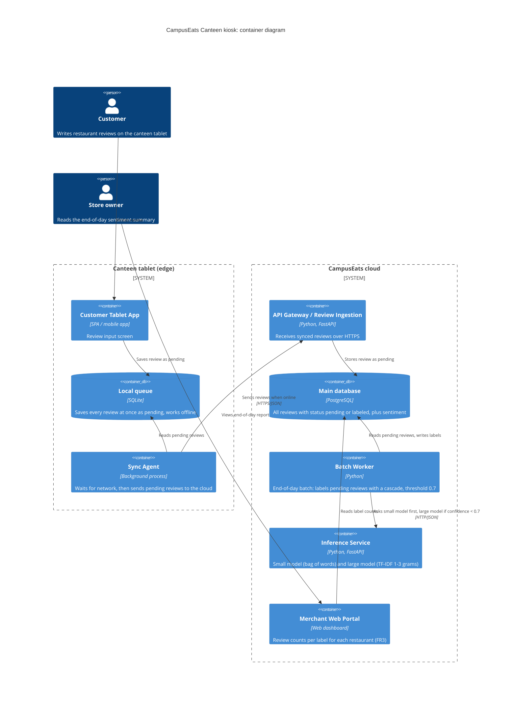

# Task 4: Deployment topologies and trade-offs

**Name / ชื่อ:** Tinnapat Sittisuwan

**Student ID / รหัสนิสิต:** 6632088321

This is **individual work**: each student completes and submits their own copy, in their own fork.

*งานนี้เป็น**งานเดี่ยว** นิสิตแต่ละคนทำและส่งงานของตัวเอง ใน fork ของตัวเอง*

**Scenario (A, B or C) / Scenario ที่เลือก:** B (Canteen kiosk)

Choose **one** scenario below. If the last digit of your student ID is odd, take A or B; if it is even, take B or C. Use your measurements from Tutorial 6 as evidence: cite run names from `results/runs.csv`. Answer in Thai or English.

เลือก scenario **หนึ่ง** ข้อด้านล่าง ถ้าเลขตัวสุดท้ายของรหัสนิสิตเป็นเลขคี่ ให้เลือก A หรือ B ถ้าเป็นเลขคู่ ให้เลือก B หรือ C ใช้ผลการวัดจาก tutorial ที่ทำไปเป็นข้อมูลอ้างอิง โดยอ้างชื่อ run จาก `results/runs.csv` จะตอบเป็นภาษาไทยหรือภาษาอังกฤษก็ได้

Facts that hold in every scenario / ข้อเท็จจริงที่ใช้กับทุก scenario:

- The large model serves at most **20 calls per second** (4 calls at once × about 200 ms each), and every call costs money.

  *large model รับได้สูงสุด **20 calls ต่อวินาที** (พร้อมกัน 4 calls × ประมาณ 200 ms ต่อ call) และทุก call มีค่าใช้จ่าย*
- The small model is fast and cheap enough to run anywhere, including inside the review service or on a kiosk, but it is much less accurate on its own.

  *small model เร็วและถูกพอที่จะรันที่ไหนก็ได้ รวมถึงภายใน review service หรือบน kiosk แต่ถ้าใช้ตัวเดียวจะแม่นน้อยกว่ามาก*

## Scenarios

**A. Owner alerts.** When a customer posts a negative review, the restaurant owner gets a push notification within **2 seconds**. At the lunch peak, CampusEats receives **40 reviews per second**. A missed alert is acceptable, but a wrong alert (for example, "your customer is unhappy" when they are happy) makes owners stop trusting alerts and, in the end, ignore them.

*เมื่อลูกค้าโพสต์รีวิวเชิงลบ เจ้าของร้านจะต้องได้รับ push notification ภายใน **2 วินาที** เวลาช่วงพีคตอนเที่ยง CampusEats ได้รับรีวิวจำนวน **40 รายการต่อวินาที** การพลาด alert ไปบ้างนั้นยอมรับได้ แต่ alert ที่ผิด (เช่น "ลูกค้าไม่พอใจ" ทั้งที่จริงๆ แล้วพอใจ) จะทำให้เจ้าของร้านไม่เชื่อถือและเลิกสนใจ alert ในที่สุด*

**B. Canteen kiosk.** A tablet in each canteen lets students leave a review on the spot. However, the canteen Wi-Fi is poor: the tablets lose their connection several times a day, for minutes at a time. The system must accept every review, even while a tablet is offline. Restaurant owners need the labels **by the end of the day**.

*มี tablet ในแต่ละโรงอาหารให้นิสิตรีวิวได้ทันที อย่างไรก็ดี การเชื่อมต่อ Wi-Fi ในโรงอาหารไม่ดี ทำให้ tablet หลุดการเชื่อมต่อวันละหลายครั้ง ครั้งละหลายนาที ระบบจะต้องรับรีวิวได้ทุกรายการแม้ขณะที่กำลัง offline อยู่ และเจ้าของร้านต้องการ label **ภายในสิ้นวัน***

**C. Weekly report.** Restaurant owners want a weekly sentiment report. Nothing in producing this report has to be real-time. **Accuracy matters most** and **cost must be minimal**.

*เจ้าของร้านต้องการรายงาน sentiment รายสัปดาห์ ไม่มีอะไรที่จะต้องทำแบบ real-time ในการออกรายงานนี้ ความแม่นยำ **(accuracy) สำคัญที่สุด** และ **ค่าใช้จ่ายต้องน้อยที่สุด***

## Topologies and patterns to choose from / Topology และ pattern ที่เลือกใช้ได้

| | Topology | Where the model runs / โมเดลรันที่ไหน |
|---|---|---|
| T1 | Model as a service, synchronous | Inference service, called for each review (today's baseline) *inference service ถูกเรียกทุกรีวิว (baseline ของวันนี้)* |
| T2 | Model as a library | Inside the review service, or on the device *ภายใน review service หรือบนอุปกรณ์* |
| T3 | Hybrid | Small model locally, large model as a remote service *small model รันในเครื่อง large model เป็น remote service* |
| T4 | Asynchronous / batch | Reviews are queued (broker, W10) or stored, and scored later in bulk *รีวิวถูกเข้าคิว (broker, W10) หรือเก็บไว้ แล้วติด label ทีหลังเป็นชุด* |

Combine one topology with any of the patterns from Tutorial 6: **fallback**, **cascade** and **cache**.

*เลือก topology หนึ่งแบบ แล้วผสมกับ pattern จาก Tutorial 6 ได้ตามต้องการ: **fallback**, **cascade** และ **cache***

## 1. Quality requirements

The three most important quality requirements for your scenario, each with a number where possible.

*quality requirements ที่สำคัญที่สุด 3 ข้อของ scenario ที่เลือก ระบุตัวเลขเมื่อทำได้*

| # | Quality | Requirement |
|---|---|---|
| 1 | Availability (การรับรีวิว) | Tablet ต้องรับรีวิวและบันทึกลง local storage สำเร็จ 100% แม้ขณะ offline (errors = 0 ตามแนวคิดเดียวกับ FR4 และผล t1-after) |
| 2 | Timeliness (batch SLA) | รีวิวที่ซิงค์ขึ้นระบบแล้วต้องได้ label และแสดงให้เจ้าของร้านเห็นภายใน 23:59 น. ของวันเดียวกัน (ไม่ต้อง real-time) |
| 3 | Accuracy | label ถูกต้องอย่างน้อย 90% (QR3) โดยใช้ cascade threshold 0.7 บน cloud ซึ่งวัดได้ 93.0% (t2-0.7) |

## 2. Design / การออกแบบ

Your topology, the patterns you add, and a container-level diagram (C4 level 2). The C4 diagram must be written in Mermaid.

*topology ที่เลือก pattern ที่เพิ่ม และ diagram ระดับ container (C4 level 2) เขียนด้วย Mermaid*

**Topology / pattern:** T4 (asynchronous / batch) + store-and-forward บน tablet, ใช้ cascade (threshold 0.7) ใน batch worker บน cloud, ไม่ใช้ cache

## 3. Evidence / หลักฐาน

Which runs support your choice? Show the numbers and, for scenario A, the capacity arithmetic: how many large-model calls per second does your design need at the peak?

*run ไหนที่สนับสนุนการตัดสินใจของนิสิต ให้นิสิตแสดงตัวเลขประกอบ และสำหรับ scenario A ให้นิสิตแสดงการคำนวณ capacity ด้วย เพื่อแสดงว่าในช่วงพีคนั้น design ของนิสิตต้องใช้ large model กี่ calls ต่อวินาที*

| Run | What it shows / แสดงอะไร |
|---|---|
| t0-small | small model เดี่ยวๆ ได้ accuracy เพียง 72.5% ต่ำกว่าเกณฑ์ QR3 (>= 90%) มาก จึงนำมาเป็นตัวสรุปผลหลักบน tablet ไม่ได้ |
| t0-large เทียบ t2-0.7 | cascade 0.7 ลด large calls 47 จุดเปอร์เซ็นต์ (100% เหลือ 53%) โดย accuracy แทบไม่ลด (93.5% เป็น 93.0%) ประหยัดต้นทุนและคุม throughput ของ batch โดยไม่เสียคุณภาพ |
| t1-after | หลักฐานเชิงแนวคิดของการแยกการรับรีวิวออกจากการติด label: เก็บรีวิวไว้เป็น pending (28 รายการ) แล้วไม่มีรีวิวหาย (errors = 0) แม้ฝั่ง inference ค้าง ตรงกับ FR4 (tablet queue เป็นกลไกที่เพิ่มเข้ามาและไม่ได้วัดใน lab) |
| t3-cache | cache ลด large calls ได้อีก 15 จุดเปอร์เซ็นต์ (53% เหลือ 38%) แต่ประโยชน์หลักคือลด latency (p50 378 เหลือ 5 ms) ซึ่งไม่จำเป็นกับ batch สิ้นวัน จึงไม่ใช้เพื่อตัดความซับซ้อนของ cache invalidation และการซิงค์ state ข้าม edge |

**Capacity (batch):** large model รับได้สูงสุด 20 calls/s (QR5) ด้วย cascade 0.7 ที่ส่งไป large 53% ระบบรองรับได้ราว 20 / 0.53 = 37.7 รีวิว/วินาที หรือมากกว่า 135,000 รีวิวต่อชั่วโมง ซึ่งเหลือเฟือสำหรับการติด label รีวิวทั้งวันภายใน 23:59 น. (QR-B2)

## 4. ADR

Use the ADR format from W5.

*ใช้รูปแบบ ADR จาก W5*

**Title:** Store-and-forward บน tablet ร่วมกับ cloud batch cascade (threshold 0.7) สำหรับ Scenario B

**Status:** Proposed

**Context:** ระบบ CampusEats ใน Scenario B ต้องรับรีวิวจาก tablet ที่ Wi-Fi หลุดบ่อยครั้งละหลายนาที โดยต้องรับทุกรีวิวแม้ offline (FR4) เจ้าของร้านต้องการ label ภายในสิ้นวัน ไม่ต้องการ real-time และ accuracy ต้องไม่ต่ำกว่า 90% (QR3) ภายใต้ข้อจำกัดของ large model ที่มีต้นทุนสูงและรับได้ไม่เกิน 20 calls/s (QR5)

**Decision:** ใช้ T4 (asynchronous / batch) เป็นแกนหลัก
- Edge (tablet): store-and-forward บันทึกรีวิวลง local SQLite queue ทันที (สถานะ pending) แล้วให้ Sync Agent ทยอยส่งขึ้น API gateway เมื่อมีเครือข่าย
- Cloud: ติด label แบบ batch ช่วงสิ้นวัน (เช่น เริ่มรัน 22:00 น. เพื่อให้ผลพร้อมก่อน 23:59 น.) ด้วย cascade threshold 0.7
- ไม่ใช้ cache pattern ทั้งบน tablet และ cloud เพื่อตัดความซับซ้อนของ cache invalidation เพราะ batch ไม่ต้องการ latency ต่ำ
- เมื่อ large model ค้างหรือล้มเหลวระหว่าง batch ให้ worker ทำ exponential backoff retry หรือคงสถานะ pending ไว้เพื่อรันซ้ำในรอบถัดไป โดยไม่ทิ้งรีวิว

**Consequences:**
- Positive:
  - รับรีวิวได้แม้ offline และไม่สูญหายเพราะเครือข่ายหลุด (แนวคิดเดียวกับ t1-after ที่ errors = 0)
  - ลดการเรียก large model เหลือ 53% เทียบกับ 100% (t0-large เทียบ t2-0.7) จึงควบคุมต้นทุนได้
  - accuracy 93.0% (t2-0.7) ผ่าน QR3 โดยมีที่ว่างเหนือเกณฑ์ 3 จุดเปอร์เซ็นต์ (วัดจาก 200 รีวิว)
  - throughput ในสภาวะปกติราว 37.7 รีวิว/วินาที (20 / 0.53) หรือมากกว่า 135,000 รีวิวต่อชั่วโมง เหลือเฟือสำหรับรีวิวทั้งวัน
- Negative:
  - เจ้าของร้านไม่ได้ผลแบบ real-time ต้องรอรอบ batch สิ้นวัน
  - ถ้า tablet เสียหายหรือสูญหายก่อนซิงค์ขึ้น cloud รีวิวที่ค้างอยู่ในเครื่องอาจหายถาวร

**Alternatives considered:**
- T1 (model as a service, synchronous): ไม่เลือก เพราะรีวิวที่ส่งขณะ Wi-Fi หลุดจะ timeout/error ทันที ทำให้รีวิวหายและผิด FR4
- T2 (small model บน tablet เท่านั้น): ไม่เลือก แม้ทำงาน offline ได้ แต่ t0-small ได้ accuracy เพียง 72.5% ต่ำกว่าเกณฑ์ 90% ของ QR3
- cache pattern (t3-cache): ไม่เลือก แม้ลด large calls ได้อีก 15 จุดเปอร์เซ็นต์ (53% เหลือ 38%) เพราะประโยชน์หลักคือลด latency ซึ่ง batch ไม่ต้องการ และไม่คุ้มกับความซับซ้อนของ cache invalidation เมื่อ deploy โมเดลใหม่
